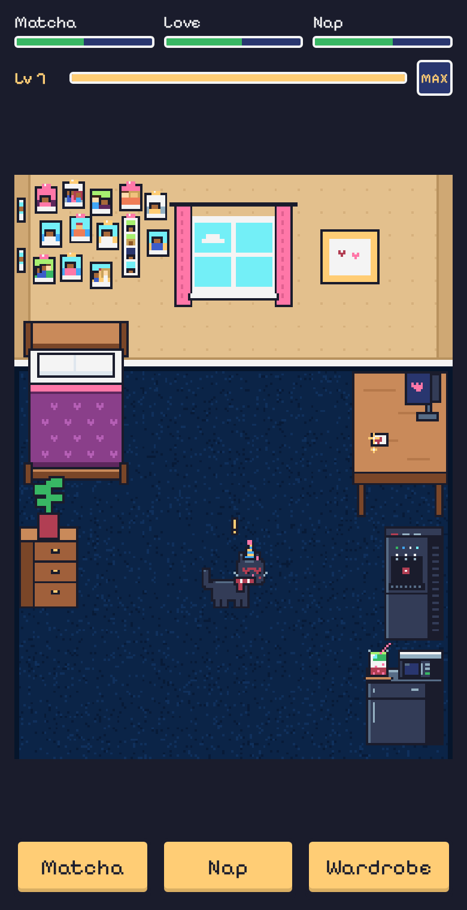

# Kitty

**A tiny pixel art pet game with a question at the end.**

Take care of a black cat in a pixel version of Nidhi's room, level it up to unlock accessories, and at level 5 it finds a letter on the desk.

[](https://github.com/danijeun/nidhi/actions/workflows/deploy.yml)


**Play it:** https://danijeun.github.io/nidhi/

<p align="center">
  
</p>

## Contents

- [Features](#features)
- [How to play](#how-to-play)
- [Getting started](#getting-started)
- [Configuration](#configuration)
- [Project structure](#project-structure)
- [Replacing the placeholder art](#replacing-the-placeholder-art)
- [Deployment](#deployment)
- [Tech stack](#tech-stack)
- [License](#license)

## Features

- **Her room, in pixels.** Bed in the corner, a wall of photos with friends, the window, a desk with a monitor, a black mini fridge with a microwave, a tri temp water dispenser and wall to wall navy carpet. Everything is drawn in code, no image files needed.
- **Pet care.** Three meters (Matcha, Love, Nap) that slowly drop. Pour a layered strawberry matcha and the cat jumps onto the microwave to sip it, naps on the bed, and hearts pop up when you pet it.
- **Experience and unlocks.** Caring earns XP; every level unlocks the next accessory in the wardrobe. Caring when a need is actually low is worth double, petting has a cooldown so it can't be spammed.
- **Dress up.** Accessories in four slots (head, face, neck, mouth), layered on the cat frame by frame.
- **The letter.** At level 5 a heart appears on the monitor. The cat jumps on the desk, reads the note, and a typewriter letter asks the question. There is a real "Let me think" option, no runaway No button.
- **Easter eggs.** A few names and objects do something special.
- **Made for phones.** Portrait 192x256 canvas scaled by whole pixels, text in the DOM so it stays crisp, nothing to install.
- **No saving on purpose.** Every refresh starts the story from the title screen.

## How to play

1. Tap to start and name the kitten.
2. Tap the floor to walk, tap the cat to pet it, tap furniture to look around.
3. Use **Matcha** and **Nap** to keep the meters up, and **Wardrobe** (or her drawer) to try on what you unlocked.
4. The letter unlocks at level 5. Normal play gets there in about 1.5 to 2.5 minutes, and it is always ready by 3.5 minutes.

## Getting started

**Requirements:** Node.js 22 (what CI uses) and npm.

```bash
git clone https://github.com/danijeun/nidhi.git
cd nidhi
npm install
npm run dev        # http://localhost:5173, also on your LAN to test on a phone
```

| Command | What it does |
|---|---|
| `npm run dev` | Dev server with hot reload |
| `npm run build` | Static site in `dist/` |
| `npm run preview` | Serve the built `dist/` locally |

**URL flags for testing**

| Flag | Effect |
|---|---|
| `?debug=1` | The letter is ready right away |
| `?xp=max` | Starts at max level with every accessory unlocked |

## Configuration

Everything personal or tunable lives in [`src/config.js`](src/config.js), so most changes never touch game logic:

| Key | What it controls |
|---|---|
| `letter`, `signoff`, `question` | The letter text, sign off and the question |
| `yesCard`, `thinkCard`, `photoCard`, `friendsCard` | The cards shown after answering and when tapping the photos |
| `flavor` | Everything the cat says (hello, nap, window, dispenser, ...) |
| `nameEggs`, `plantEgg` | Easter eggs |
| `meters` | Starting values, decay per second, how much each action restores |
| `xp` | XP per action, level costs, which accessory each level unlocks |
| `trigger` | Level that unlocks the letter and the safety net time |

Put a real photo at `public/assets/photo.jpg` for the frame on the wall.

## Project structure

```
├── index.html             # HUD, wardrobe, letter and card overlays
├── public/assets/         # photo.jpg
├── src/
│   ├── config.js          # all text and tuning
│   ├── main.js            # Phaser game setup, title and naming flow
│   ├── state.js           # in memory state for one visit
│   ├── sfx.js             # tiny WebAudio sound effects
│   ├── art/placeholder.js # pixel art drawn in code: cat, accessories, room, furniture
│   ├── objects/Cat.js     # cat = base sprite + one sprite per accessory
│   ├── scenes/Boot.js     # registers the art
│   ├── scenes/Room.js     # the game: layout, taps, care, XP, the letter cutscene
│   ├── ui/ui.js           # DOM overlays: meters, XP bar, bubble, wardrobe, letter
│   └── style.css
└── .github/workflows/deploy.yml
```

## Replacing the placeholder art

All art is generated in [`src/art/placeholder.js`](src/art/placeholder.js), laid out the way an Aseprite or Pixel Studio export would be. Each sheet is one row of 32x32 frames in this order (see `TAGS`):

| Frames | Tag | | Frames | Tag |
|---|---|---|---|---|
| 0 to 1 | idle | | 12 | sit |
| 2 to 5 | walk | | 13 | jump |
| 6 to 7 | happy | | 14 to 15 | read |
| 8 to 9 | sip | | 16 to 17 | drink (on the microwave) |
| 10 to 11 | sleep | | | |

Draw the cat facing right. Draw every accessory on its own layer of the same canvas and export it as its own sheet with the same frames, so it lines up automatically. Then load the PNGs in `src/scenes/Boot.js` under the same keys (`cat`, `acc-bow`, ...) instead of generating them. The room canvas is 192x256.

## Deployment

Every push to `main` builds the site with Vite and publishes it to GitHub Pages through [`.github/workflows/deploy.yml`](.github/workflows/deploy.yml). `vite.config.js` uses `base: './'`, so the build also works from any subfolder or static host (Netlify, Vercel). A `noindex` meta tag keeps the page out of search engines.

## Tech stack

- [Phaser 4](https://phaser.io/) for rendering, tweens, particles and input
- [Vite](https://vite.dev/) for the dev server and build
- Plain HTML and CSS for the overlays, [Pixelify Sans](https://fonts.google.com/specimen/Pixelify+Sans) for text
- [Sweetie 16](https://lospec.com/palette-list/sweetie-16) palette as the base for the pixel art

## License

Personal project by [@danijeun](https://github.com/danijeun). No license is granted, so all rights are reserved.
